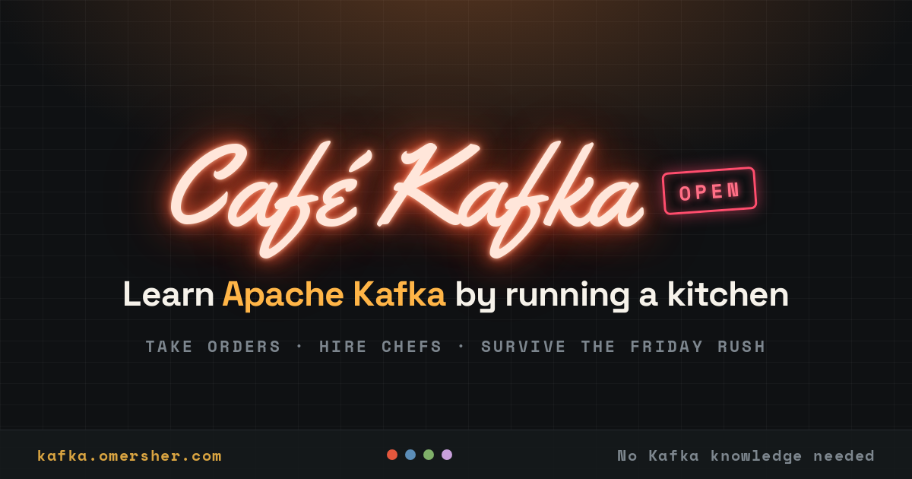

# Café Kafka

**Learn Apache Kafka by running a restaurant kitchen.** Live at [kafka.omersher.com](https://kafka.omersher.com).

No Kafka knowledge needed. You take orders, hire chefs and survive the Friday rush, and every move maps to a real Kafka idea. Switch on **Kafka X-ray** to see the Kafka words under the kitchen words, or open **Code** to watch the matching Node.js + KafkaJS lines light up as the kitchen runs them.



## What's here

It's one self-contained page with no build step and no dependencies, apart from Google Fonts.

| File | What it is |
|---|---|
| `index.html` | The whole app: markup, styles and script |
| `og.png` | Link-preview image (1200×630) |
| `favicon-32.png`, `icon-192.png`, `icon-512.png`, `apple-touch-icon.png` | Icons |
| `art/og.html`, `art/icon.html` | Sources for the preview image and icons |

## Run locally

Open `index.html` in a browser, or:

```bash
npx serve .
```

## Regenerate the preview image and icons

```bash
cd art
docker run --rm -v "$PWD/..":/w zenika/alpine-chrome:124 --no-sandbox --hide-scrollbars \
  --default-background-color=00000000 --virtual-time-budget=8000 \
  --window-size=1200,630 --screenshot=/w/og.png file:///w/art/og.html
# icons: icon.html?s=<size>, plus &sq=1 for the square apple-touch-icon
```

## Hosting

It's served from my home server. An `nginx:alpine` container in the `sites` stack serves these files read-only from `/hosted-apps/kafka-site`, behind Traefik and a Cloudflare Tunnel.
